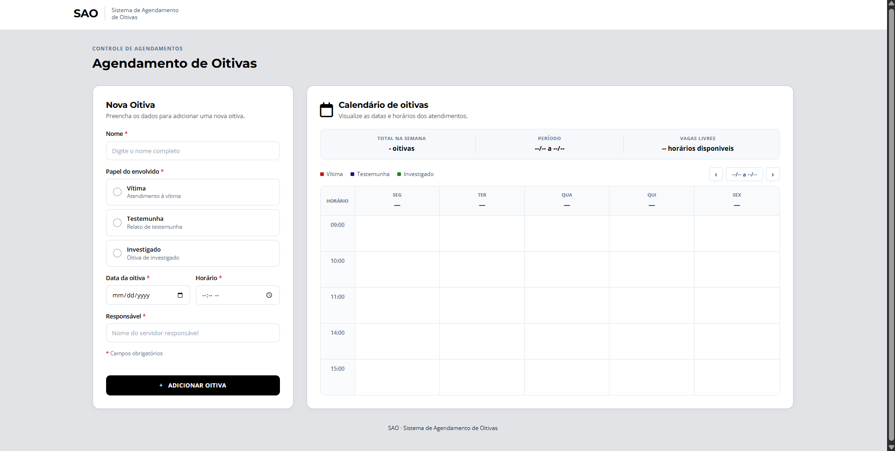

# Projeto-Integrador-3-semestre
# SAO — Sistema de Agendamento de Oitivas

Sistema web desenvolvido como Projeto Integrador do 3º semestre, com o objetivo de organizar e facilitar o gerenciamento de agendamentos de oitivas em uma delegacia especializada.

## 📌 Sobre o projeto

Atualmente, o agendamento de oitivas pode ser realizado por meio de agendas físicas, planilhas ou aplicativos de mensagens, dificultando o controle de horários e aumentando o risco de conflitos de pauta e retrabalho.

O **SAO (Sistema de Agendamento de Oitivas)** propõe uma solução web simples e centralizada, permitindo que servidores e investigadores organizem, consultem e gerenciem os atendimentos.

O sistema contempla três tipos de envolvidos:

- **Vítima:** atendimento à vítima.
- **Testemunha:** registro de depoimento de testemunha.
- **Investigado:** agendamento de oitiva de investigado.

## 🎯 Objetivo

Desenvolver uma aplicação web que permita agendar, consultar, remarcar e cancelar oitivas de maneira simples, intuitiva e organizada, reduzindo conflitos de horários e o trabalho manual.

## 🖥️ Interface do sistema

A interface foi desenvolvida com foco em simplicidade, organização e facilidade de utilização.

### Tela principal — Agendamento de Oitivas

A tela principal apresenta duas áreas:

**1. Cadastro de nova oitiva**
- Nome do envolvido.
- Tipo de envolvido (vítima, testemunha ou investigado).
- Data da oitiva.
- Horário do atendimento.
- Servidor responsável.

**2. Calendário de oitivas**
- Visualização dos horários disponíveis.
- Organização dos agendamentos durante a semana.
- Identificação dos atendimentos por tipo de envolvido.
- Indicadores de quantidade de oitivas e vagas disponíveis.
- Navegação entre períodos.

## ⚙️ Funcionalidades previstas

- [x] Estrutura visual da tela de agendamento.
- [x] Formulário de cadastro de oitivas.
- [x] Identificação dos tipos de envolvidos.
- [x] Estrutura visual do calendário semanal.
- [ ] Cadastrar e salvar novas oitivas.
- [ ] Consultar oitivas agendadas.
- [ ] Remarcar datas e horários.
- [ ] Cancelar ou excluir agendamentos.
- [ ] Pesquisar oitivas por data.
- [ ] Pesquisar oitivas por responsável.
- [ ] Atualizar automaticamente os horários disponíveis.

## 🛠️ Tecnologias utilizadas

| Tecnologia | Finalidade |
|---|---|
| HTML5 | Estrutura das páginas |
| CSS3 | Estilização e identidade visual |
| JavaScript | Lógica, interatividade e gerenciamento dos agendamentos |
| LocalStorage | Armazenamento dos dados no navegador |

O projeto prevê a utilização do LocalStorage, dispensando inicialmente a necessidade de um banco de dados externo.

## 📋 Orientações para o desenvolvimento JavaScript

Esta seção apresenta os requisitos que precisam ser implementados para integrar o JavaScript à interface desenvolvida.

### 1. Cadastro de oitivas

Ao clicar em **Adicionar Oitiva**, o sistema deverá:

- Verificar se todos os campos obrigatórios foram preenchidos.
- Validar os dados informados.
- Registrar o nome, tipo de envolvido, data, horário e responsável.
- Impedir o cadastro de duas oitivas no mesmo horário, quando houver conflito de agenda.
- Atualizar o calendário automaticamente após o cadastro.

### 2. Calendário dinâmico

O calendário deverá:

- Exibir os agendamentos de segunda a sexta-feira.
- Organizar os horários disponíveis: 09h, 10h, 11h, 14h e 15h.
- Mostrar os dados da oitiva no respectivo dia e horário.
- Diferenciar visualmente os tipos de envolvidos:
  - Vermelho: Vítima.
  - Roxo: Testemunha.
  - Verde: Investigado.
- Atualizar os indicadores de total de oitivas e vagas disponíveis.
- Permitir navegar entre as semanas.

### 3. Consulta e gerenciamento

Será necessário implementar mecanismos para:

- Consultar os dados de cada agendamento.
- Pesquisar por data.
- Pesquisar pelo nome do responsável.
- Selecionar uma oitiva existente para edição.
- Remarcar uma oitiva, alterando sua data ou horário.
- Cancelar ou excluir uma oitiva.

### 4. Armazenamento com LocalStorage

Os dados deverão permanecer salvos mesmo após fechar ou atualizar o navegador.

O JavaScript deverá:

- Salvar os agendamentos no LocalStorage.
- Recuperar os registros ao abrir a aplicação.
- Atualizar os dados sempre que houver cadastro, alteração ou exclusão.
- Evitar perda de informações durante a navegação.

### 5. Integração com o HTML e CSS

O JavaScript deverá ser integrado à interface existente, preservando:

- O layout atual.
- As cores e identificações dos tipos de envolvidos.
- A organização do formulário e do calendário.
- A identidade visual do SAO.

**Importante:** a implementação deve aproveitar a estrutura HTML e CSS já desenvolvida, evitando reconstruir a interface sem necessidade.

## 👥 Integrantes do grupo

- Alessander da Silva Oliveira Junior
- Sabrina de Oliveira Zago Capanema
- Lucas Garcia de Paula
- Lucas Gonçalves Dias
- João Marcos Ribeiro da Silva
- Victor Rafael Soares de Almeida
- Rafael Santos Rodrigues

## 📚 Projeto Integrador — 3º Semestre

Desenvolvimento de uma aplicação web utilizando boas práticas de desenvolvimento de software.

**SAO — Sistema de Agendamento de Oitivas.**